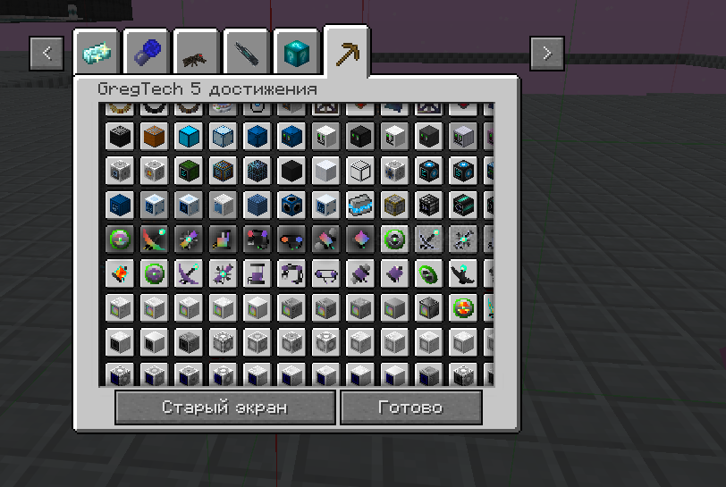
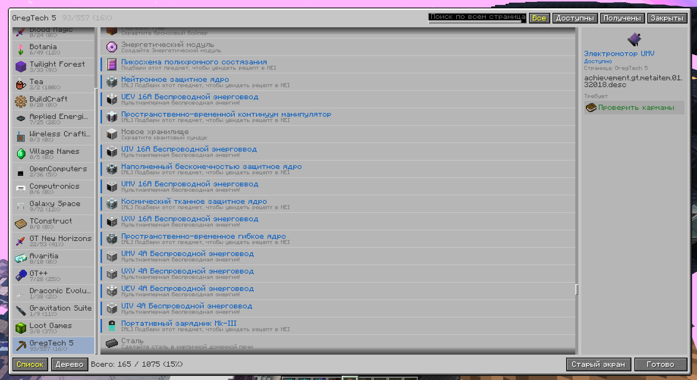
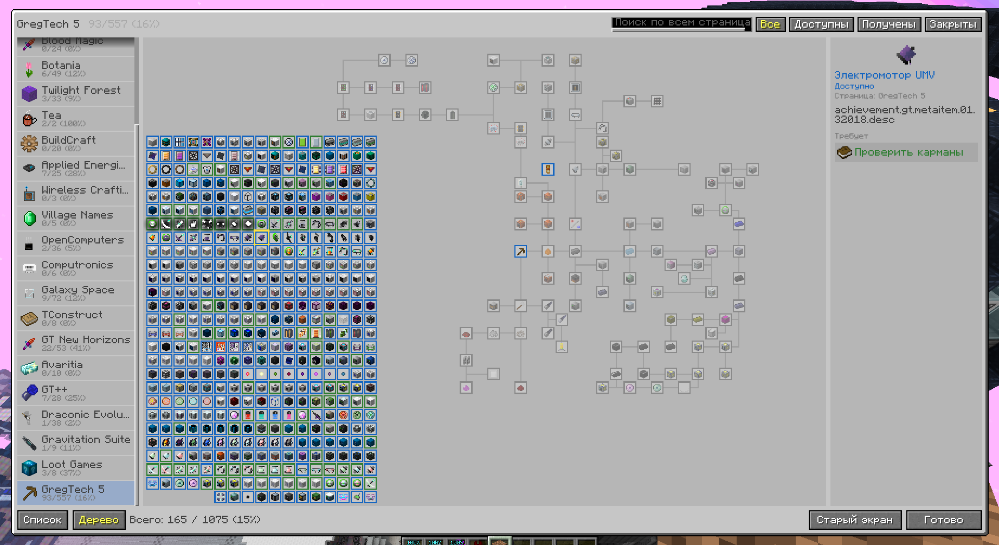

# Achievements NH

A full-screen achievements screen for **GT New Horizons 2.9** (Minecraft 1.7.10).

The vanilla achievements screen (and Better Achievements on top of it) is a small fixed window. GregTech alone adds 557 achievements, mostly as a wall of icons without names. Achievements NH replaces it with a readable screen: a page list with progress, search across all pages, status filters, a details panel, and a zoomable tree view.

Client-side only. Built on ModularUI2.

| Before | List view | Tree view |
| --- | --- | --- |
|  |  |  |

## Features

**Screen**
- Fills most of the screen; size and column widths are configurable. A dark backdrop hides the world behind it.
- The page list shows an icon, a name and `unlocked/total (%)` for each page. Options: hide completed pages, sort pages by progress.
- The footer shows total progress across all pages.

**List view**
- Each row shows the item, the name in its status colour (green unlocked, blue available, grey locked) and the description.
- Search by name and description across **all** pages.
- Filters: all / available / unlocked / locked. Sort: default order / by status (available first) / by name.

**Tree view**
- Vanilla-style tree, with L-shaped links and arrows coloured by status.
- Mouse wheel zooms toward the cursor and dragging pans. Both are smooth and update every frame, not at the 20 Hz input tick.
- **Auto** lays a page out from its parent links instead of the mod's positions. This turns the GregTech grid into readable trees, with unconnected achievements in a compact grid.
- A minimap appears when a page does not fit; click or drag on it to move the view.
- Search and filters dim non-matching nodes instead of hiding them.

**Details panel**
- Shows the description, status, page, and whether the achievement is special.
- **Requires** / **Unlocks** links jump to the target achievement, switching page if needed.

**Extras**
- **NEI:** hover an achievement and press `R` for the recipe or `U` for the usage of its item.
- **Pinned achievements:** pin what you are working towards. Pins are collected on a "★ Pinned" page shown first in the page list.
- **Next available:** jumps to the next achievement you can unlock right now.
- **Old screen:** opens Better Achievements (or vanilla) if you need it.

## Requirements

| | |
| --- | --- |
| Minecraft / Forge | 1.7.10 / 10.13.4.1614 (GTNH 2.9.0) |
| Required | ModularUI2 2.3.94+ (ships with GTNH 2.9) |
| Optional | NotEnoughItems (R/U lookup), Better Achievements (its screen stays available via "Old screen") |
| Side | Client only, safe to join servers without it |

## Installation

Put `achievementsnh-<version>.jar` into `mods`. Use the jar **without** `-dev` or `-sources` in its name; the `-dev` jar crashes in a normal game with `NoSuchMethodError`.

## Hotkeys

These work while the search field is not focused.

| Key | Action |
| --- | --- |
| `Ctrl+F` | Focus search |
| `Tab` | Toggle list / tree |
| `↑` / `↓` | Previous / next page |
| `Enter` | Show the selected achievement |
| `N` | Next achievement you can unlock now |
| `P` | Pin / unpin the selected achievement |
| `R` / `U` (hover) | NEI recipe / usage of the achievement's item |
| `Esc` | Close, back to the pause menu |

## Configuration

Open it from the mod list (Achievements NH → Config) or edit `config/achievementsnh.cfg`. Changes apply the next time the screen opens.

| Option | Default | Description |
| --- | --- | --- |
| `enabled` | `true` | Replace the achievements screen |
| `hideSpoilers` | `false` | Vanilla rules: hide locked achievements far from anything unlocked |
| `panelWidthPercent` / `panelHeightPercent` | `94` / `92` | Window size, % of the screen |
| `sidebarWidth` / `detailsWidth` | `112` / `140` | Column widths, GUI pixels |
| `maxRows` | `600` | Row limit in the list (search across all pages can match thousands) |
| `backgroundOpacity` | `85` | Backdrop opacity, % |
| `showMinimap` | `true` | Tree minimap |
| `showFps` | `true` | FPS counter in the footer |
| `autoLayoutPages` | — | Pages with auto layout (toggled by the **Auto** button) |

Pins are stored in `config/achievementsnh-pinned.txt`, one achievement id per line, shared by all worlds.

## Building

```
./gradlew spotlessApply build
```

Requires JDK 17+ to start Gradle; the GTNH toolchain downloads the rest. The release jar is in `build/libs/`.

## Known limitations

- Some GregTech achievements show a raw key such as `achievement.gt.metaitem.01.32018.desc` as their description. That is a missing translation in GregTech; the key is shown as is.
- Auto layout is saved by page name as displayed, so switching the game language resets it.

## License

MIT, see [LICENSE](LICENSE).
